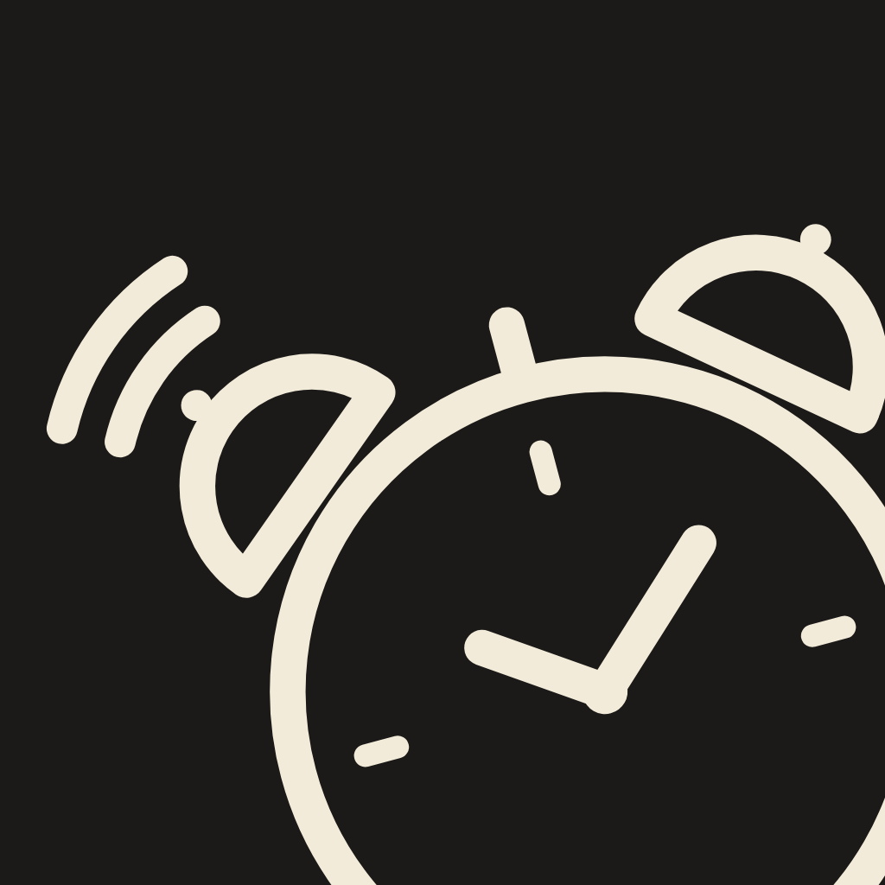
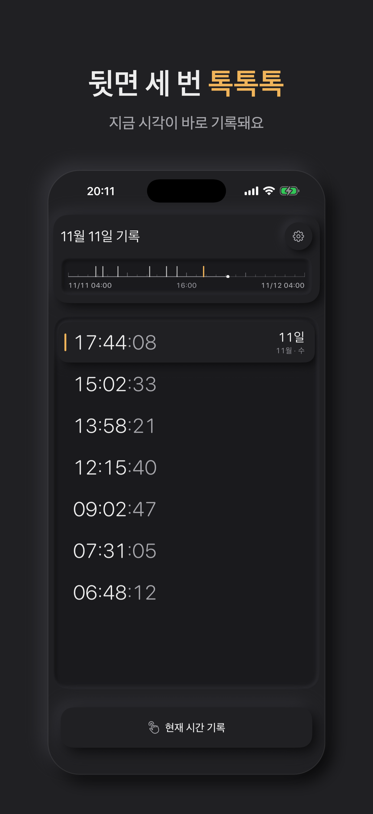
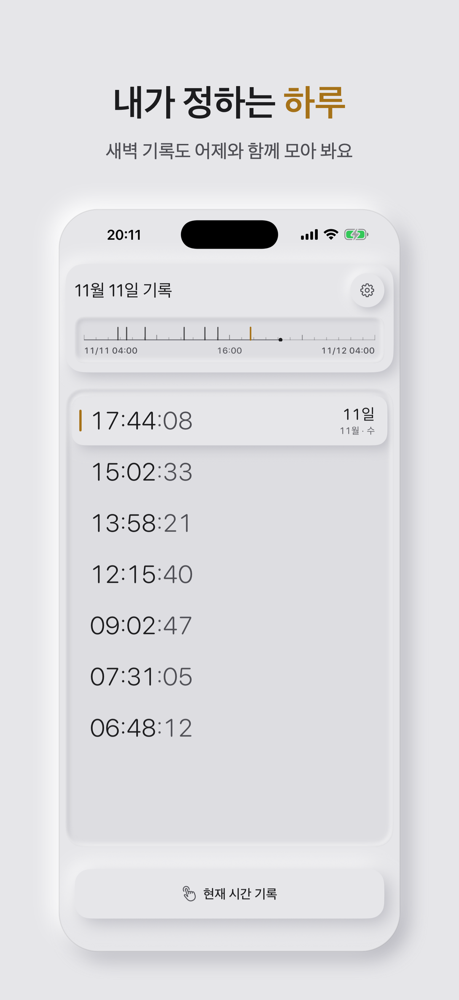
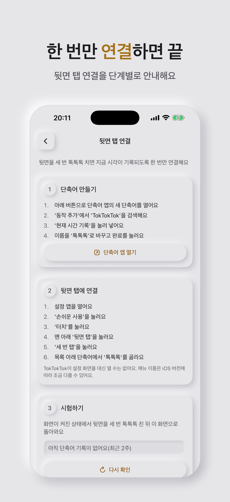
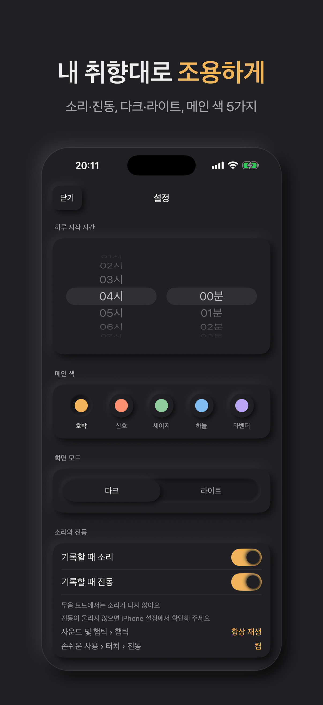
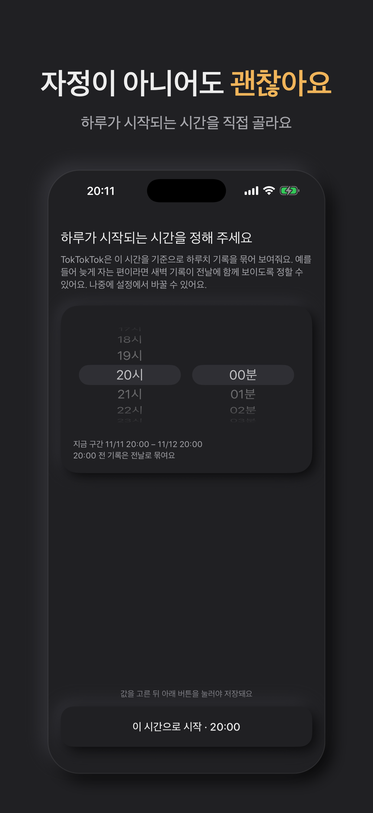

  

<h1 align="center">TokTokTok · 톡톡톡</h1>

  iPhone 뒷면을 세 번 톡톡톡 치면, 지금 이 순간의 시각이 남아요.

  
  
  

  
  
  
  
  

## 어떤 앱인가요

새벽에 잠깐 깬 시각, 약을 먹은 시각, 버스에 탄 시각처럼 **글을 쓰지 않고 시각만 남기고 싶은 순간**을 위한 앱이에요. 뒷면을 세 번 치거나 버튼을 한 번 누르면 끝이고, 기록은 내가 정한 하루 시작 시간을 기준으로 묶여 보여요.

## 주요 기능

| 기능 | 설명 |
|---|---|
| 지금 시각 기록 | 앱 안 버튼, 뒷면 세 번 탭, 단축어로 입력 없이 저장해요 |
| 기록 알림 | 저장되면 짧은 마림바 소리와 진동이 한 번 나요. 설정에서 각각 끌 수 있고, 무음 모드에서는 소리가 나지 않아요 |
| 뒷면 탭 연결 안내 | 단축어 만들기부터 손쉬운 사용 › 터치 › 뒷면 탭 › 세 번 탭 연결까지 단계별로 안내하고, 연결되면 마지막 기록으로 확인해요 |
| 내가 정하는 하루 | 하루 시작 시간을 직접 정해요(예: 04:00). 새벽 기록이 전날 기록과 함께 보여요 |
| 하루 화면 | 경계부터 경계까지의 하루 눈금과 최신순 기록 목록. 날짜는 바뀌는 첫 기록에만 보여요 |
| 기록 지우기 | 기록을 오른쪽으로 밀어 하나씩, 또는 설정의 ‘오늘 기록 지우기’로 한꺼번에 지워요 |
| 설정 | 하루 시작 시간, 메인 색 5가지, 다크·라이트, 소리·진동 |

> [!NOTE]
> 뒷면 탭 기록은 화면이 켜져 있을 때만 돼요. 화면이 꺼진 상태에서는 iPhone이 뒷면 탭을 인식하지 않아요. 기록 시각은 단축어가 앱을 실행한 순간이라 손가락으로 탭한 순간과 조금 다를 수 있어요.

## 개인정보

계정, 서버, 광고, 분석 도구가 없어요. 기록과 설정은 iPhone 안에만 저장되고 개발자에게 보내지 않아요. 사용자가 켜 둔 iCloud·컴퓨터 백업에만 포함될 수 있어요.

- [개인정보처리방침](https://toktoktok-nine.vercel.app/privacy/)
- [지원·자주 묻는 질문](https://toktoktok-nine.vercel.app/support/)
- 문의: toktoktok.support@gmail.com
